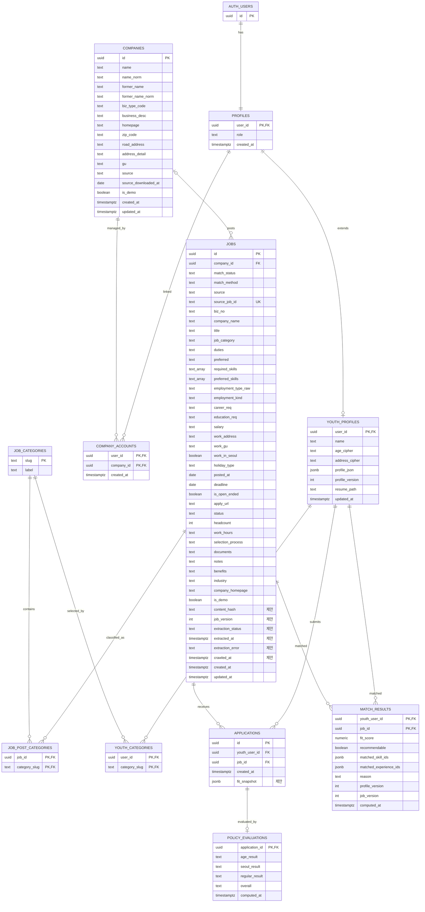

# PRD.md — 서울잇다 (가칭)

> 상태: 팀 협의용 v0.3 / 매칭 배점 갱신 2026-11-20  
> 결정 원칙: **[확정]** 기존 기획서·데이터 아키텍처 합의 / **[미정]** 회의에서 확인할 사항 / **[제안]** 개발 편의를 위한 임시 설계  
> 개발 계약: [공유 API](docs/api-spec.md) · [정제 JSON/점수 상세](docs/matching-spec.md). 20/40/25/15 배점과 양쪽 AI JSON 정제는 확정, 세부 산식은 구현 기본안.
> 공고·기업 정본: `gangso-matching-share/db-companies.sql`, `db-jobs.sql`, `type-job.ts` (테이블명 `companies` / `jobs`)

## 0. 한 줄 정의와 성공 기준

**[확정]** 서울형 강소기업의 유효 채용공고와 서울 청년의 이력서를 분석하여, 청년에게는 적합성순 공고 추천과 **플랫폼 내 지원**, 기업에는 **자사 공고에 지원한 사람만** 대상으로 적합성·정책 기본요건 필터를 제공하는 양방향 매칭 서비스.

**데모 성공 조건:** 테스트 청년이 가입(관심 직무 다중) → (선택) PDF 업로드 → AI 이력서 JSON → 적합성순 목록 + 적합 시 추천 이유 최대 3 → `지원하기` → 테스트 기업 계정에 해당 지원자와 예비진단 결과가 나타남.

## 1. 핵심 사용자와 상황·문제정의

- **[확정] 청년:** 서울형 강소기업에 취업을 희망하며, 여러 채용공고 중 자신의 기술·프로젝트 경험에 맞는 공고를 찾기 어려운 서울 청년.
- **[확정] 기업:** 별도 채용공고 입력 없이 기존 자사 공고에 실제 지원한 청년들을 직무 적합성 및 정책 기본요건에 따라 검토하려는 서울형 강소기업.
- **사용 시점:** 청년은 구직·지원 단계, 기업은 지원서 접수·검토 단계.
- **막히는 순간:** 청년의 공고 탐색/역량 해석 부담, 기업의 지원자 이력서 비교/정책 요건 확인 부담.
- **근거:** 서울형 강소기업 및 채용공고의 기존 공공 제공과 정책 지원은 확인됨. **[미검증]** 구직·채용 불편의 실제 발생 빈도, 이 서비스가 기존 방식보다 낫다는 사용자 조사 및 실측 근거는 별도 확보 필요.

## 2. 현재 해결 방법 및 차별성

- **기존:** 서울시 일자리포털의 강소기업 소개·채용정보, 일반 채용 플랫폼의 공고 검색·추천, 기업의 기존 지원자 검토.
- **차별점 [확정]:** `서울형 강소기업 인증·청년 정책 기본요건` + `이력서 근거 기반 직무 적합성` + `청년이 플랫폼 안에서 직접 지원하고 기업이 받는 연결`을 하나의 흐름으로 구성.
- **주의:** 서울형 강소기업 **인증**, **유효 채용공고**, **우리 플랫폼 참여기업**은 다른 상태. 공개 공고가 존재해도 기업이 우리 플랫폼에 참여한 것은 아님.

## 3. MVP 범위

### P0 — 꼭 동작해야 할 하나의 완결된 흐름

1. 청년/기업 역할 선택 및 **Supabase Auth** 로그인·가입.
2. **청년 가입:** 이름, 나이, 주소, 이메일, 비밀번호, **관심 직무 카테고리(다중, 우리 택소노미)**. 이력서 PDF는 **선택**.
3. **청년 이력서(있는 경우):** PDF 업로드 → LLM이 전공·보유 기술·프로젝트/경력을 **닫힌 스킬 사전 id 기준 JSON**으로 추출. 희망 직무는 가입값을 덮어쓰지 않음.
4. 연령·서울 거주·(공고 화면에서는) 정규직 여부 **정책 기본요건 예비진단**; `기본요건 충족 가능 / 추가 확인 필요 / 기본요건 불일치`. 신규채용·12개월 근속은 판정하지 않고 안내만.
5. **메인:** 유효 강소기업 공고 **전체**를 규칙 기반 직무 적합성순으로 정렬. 정책 점수는 적합도에 합산하지 않음. **진짜 적합(`recommendable`)인 경우만** 한줄 추천 이유, **최대 3건**. 없는 정보는 문장에 넣지 않음.
6. **마이페이지:** 이름·주소·나이 수정, 이력서 재업로드(재추출, `profile_version++`).
7. **지원:** `지원하기` → 청년 ID·공고 ID 내부 지원 기록. 외부 채용시스템 접수로 표시하지 않음.
8. **기업:** 연결된 기업 계정의 **자사 공고 지원자만** 조회. 적합성순·정책 예비진단 필터. 타 기업 지원자·이력서 접근 금지.

### P1 / 제외

- **P1:** 직무 적합도 설명 고도화, 임베딩/`pgvector`, 기업 지원금 체크리스트 상세화, 추출 JSON 화면 수정.
- **제외:** 청년일자리도약장려금 신청 대행, 전 서울시 채용공고 포괄, 실시간 메시징, 면접·채용상태 관리, 운영자 관리 대시보드, 정식 기업 실명 인증의 완전 구현.

## 4. 사용자 흐름 및 예외

### 청년

`역할 선택 → Auth 가입(이름·나이·주소·이메일·비번·관심 직무 다중, 이력서 선택) → 메인(적합성순 + 조건부 추천 최대 3) → 지원하기 → 내부 접수 확인`  
`마이페이지: 이름/주소/나이 수정, 이력서 재업로드`

### 기업

`기업 계정 로그인 → 연결된 기업·자사 공고 탭 → 해당 공고의 플랫폼 지원자만 목록 → 적합성순·정책 종합 필터 → 항목 칩(연령/거주/정규직) + 고지 문구`

### 필수 예외

- 이력서 없음: 관심 직무 일치 여부만으로 정렬(총점은 미계산 null). **추천 배지·이유 0건** (근거 스킬/경험 없음).
- PDF 파싱 실패: 구체적 오류 표시, 재업로드. 대체 수동 입력 **[미정]**.
- 나이/주소: 가입 필수. 이력서에서 추정하지 않음. 자동 만 나이 갱신 없음.
- 공고 없음/마감: 빈 상태와 공식 원문 안내; `status=closed` 추천 제외.
- 이미 지원한 공고: 중복 신청 방지; 취소 가능 여부 **[미정]**.
- 미참여기업 공고: 플랫폼 지원 의사를 기업에 실제로 전달할 수 있는지 구분. **[미정] 외부 원문 링크만 제공 vs 미전달 상태의 관심 기록**.
- 정책: 지원금 수급 확정 문구 사용 금지. `추가 확인 필요`는 주로 공고 정규직 여부 불명.
- 이력서 LLM 실패: 추출 실패 안내. 목록 정렬은 카테고리만으로 유지, 추천 이유 없음.
- 추천 이유는 근거 템플릿이 MVP 기본안. 선택적 LLM 이유 생성 실패 시 해당 카드는 이유 없이 정렬만 표시.

---

## 5. 데이터 아키텍처

### 5-1. 기술 스택 **[확정: 백엔드 핵심]**

- Next.js + TypeScript + Tailwind CSS (단일 앱) **[제안: 프론트]**
- **Supabase Auth** + PostgreSQL + RLS + Storage(이력서 PDF)
- LLM **한 가지 [미정: Gemini vs OpenAI]** — **공고·이력서 매칭 필드 JSON 정제**. 점수는 서버 규칙으로 계산
- Vercel 배포. API 키·복호화 키는 서버 환경변수만.
- **[확정] `pgvector`/임베딩 본선 제외.** 공고 수가 늘고 사전으로 못 덮는 동의어가 핵심이 되면 P1.

### 5-2. AI를 쓰는 시점 **[확정]**

| 시점 | LLM | 내용 |
|------|-----|------|
| 이력서 최초·재업로드 | **사용** | 전공·스킬·경험을 lexicon id JSON으로 고정 |
| 공고 신규·본문 변경 적재 | **조건부 사용** | 변경 공고의 카테고리·스킬·경험요건·경력조건을 AI JSON으로 정제 |
| 메인 목록 정렬 | **사용 안 함** | `직무 20 + 기술·역량 40 + 경험·프로젝트 25 + 경력조건 15` |
| 추천 한줄 이유 | **MVP 미사용 제안** | 근거 템플릿 최대 3건. LLM 이유 생성은 선택 확장 |
| 정책 예비진단, 마감, RLS, 중복지원 | **사용 안 함** | 규칙 |

### 5-3. 파이프라인

```
[Supabase Cron, 매일 1회]
  --> [Edge Function: ingest-jobs]
        --> 포털 진행 공고 목록 수집
        --> 정규화 + 강소기업 연결 + source_id 기준 upsert
        --> 상태/마감일 항상 갱신, content_hash 비교
        --> 신규/본문 변경 공고만 extraction_status='pending' 설정
  --> [Edge Function: enrich-jobs]
        --> pending 공고를 작은 묶음으로 조회
        --> AI로 카테고리·스킬·경험요건·경력조건 JSON 정제
        --> 추출 필드와 job_version 저장
        --> 성공/실패 상태 및 오류 기록

[Auth 청년] --> youth_profiles (나이·주소 암호화)
            --> youth_categories[] (관심 직무 다중)
            --선택 PDF--> Storage --LLM--> profile_json (skills/experiences id)

[규칙 스코어] youth × job --> fit, recommendable, evidence
[recommendable ∩ top] --최대 3, 근거 템플릿--> reason
[지원] applications
[서버] 나이·주소 복호화 --> policy_evaluations (결과만 저장)
[기업] 자사 applications ⋈ fit ⋈ policy_evaluations
```

**[제안: 실행 인프라]** 별도 크롤링 서버는 두지 않는다. Supabase Cron이 하루 1회 `ingest-jobs` Edge Function을 실행하고, 수집 완료 후 `enrich-jobs` Edge Function을 호출한다. 두 함수는 별도 실행 단위로 두어 수집 실패와 역량 처리 실패를 구분한다. Edge Function 간 호출은 DB 커밋 후 수행한다.

**[제안: 실패 복구]** 별도 큐 테이블 대신 `jobs`의 추출 상태를 이용한다. 신규/본문 변경 공고는 `pending`, 성공은 `completed`, 실패는 `failed`와 오류 요약을 기록한다. 다음 실행에서 `pending` 및 재시도 가능한 `failed` 공고를 다시 처리한다. 재시도 횟수·간격은 구현 시 확정한다. 같은 `source_id`와 같은 `content_hash`인 공고는 LLM을 다시 호출하지 않는다.

**[제안: 범위 제한]** Edge Function 처리 시간 제한을 고려해 `enrich-jobs`는 한 번에 제한된 건수만 처리하고, 남은 건은 다음 호출에서 처리한다. 전체 실행 로그는 `ingestion_runs`에 시작/종료 시각, 수집·신규·변경·종료·LLM 성공/실패 건수와 실행 결과를 남긴다. 이 로그 테이블은 구현 전 최종 확정한다.

### 5-4. 공고 수집·역량 추출 **[수집·변경 감지: 확정 / 자동화 구현: 제안]**

원문: [서울형 강소기업 채용정보](https://job.seoul.go.kr/hmpg/bcop/hrmg/hrmgListPage.do)

목록 필터·속성: 경력, 상태(진행중/종료), 근무형태(정규직/계약직/인턴), 검색어. 상세·연관데이터에서 회사명, 모집내용, 급여, 근무지, 구인번호. `모집직종코드`는 상세 또는 [서울시 일자리포털 채용정보 OpenAPI](https://www.data.go.kr/data/15047488/openapi.do?recommendDataYn=Y)로 보조(강소기업 필터는 포털 목록이 기준).

| DB 컬럼 | 출처 | 용도 |
|--------|------|------|
| `source_id`, `source_url` | 구인번호/상세 URL | upsert 키 |
| `company_id` | 회사명+주소 등 교차 | 기업 계정 연결. **이름만으로 병합 금지** |
| `title` | 모집내용 | 카테고리 키워드, 스킬 스캔 |
| `employment_type` | 근무형태 | 지원금 정규직 판정 |
| `career_req` | 경력 | AI 정제 후 신입/경력·최소/최대 개월로 경력조건 15점 계산 |
| `status`, `deadline` | 상태·마감 | open만 추천 |
| `workplace`, `salary_text` | 근무지·급여 | 표시 |
| `duties_text`, `requirements_text` | 상세 본문 | 스킬 사전 스캔용 `search_text` |
| `occupation_code` | 직종코드 | 카테고리 1:N 매핑 |
| `content_hash`, `job_version` | 본문 해시·버전 | 변경 시에만 규칙 스캔 및 추출 갱신 **[제안: DB 필드 추가]** |

**현재 데이터 적재:** 실제 공고 80건은 사전 추출 후 `db-seed-gangso-jobs.sql`로 일회성 적재했다. 현재 `db-jobs.sql`에는 `content_hash`, `job_version`, 추출 상태 컬럼이 없고 공고의 `required_skills`·`preferred_skills`는 텍스트 배열이다. 아래 자동 파이프라인은 **[제안: 미구현]** 이다.

**일일 수집 함수 `ingest-jobs`:**

1. 포털의 진행 공고 목록을 전수 조회한다. 목록에서 확인한 `source_id`를 공고 식별자로 쓴다.
2. 회사·공고 필드를 정규화하고 강소기업 명단과 결합한다. 기업명만으로 자동 병합하지 않는다.
3. 공고의 매칭·추천에 영향을 주는 본문 필드로 `content_hash`를 계산한다. 매핑 컬럼을 정한 뒤 해시 입력 필드를 고정한다.
4. `source_id`로 upsert한다. 신규 공고는 `job_version=1`; 본문 해시가 바뀐 기존 공고는 버전을 1 올리고 추출 상태를 `pending`으로 설정한다. 해시가 같으면 본문·추출 결과는 유지하고 `status`, `deadline`, `crawled_at` 등 수집 메타데이터만 갱신한다.
5. 그날 목록에 없던 기존 open 공고는 `closed` 처리한다. 수집 전체가 실패했거나 부분 조회에 그친 경우에는 누락을 종료 처리하지 않는다.
6. `ingest-jobs`가 성공적으로 적재를 마친 뒤 `enrich-jobs`를 호출한다. 본선은 기존 **사전 덤프 10~20건**도 동일한 upsert·해시·추출 경로를 사용한다. 인증기업 여부는 열린데이터 `OA-23042`와 교차한다.

**역량 처리 함수 `enrich-jobs`:** `pending` 공고를 제한된 배치로 가져와 AI 카테고리·스킬·경험요건·경력조건 정제를 수행한다. LLM 입력은 공고 제목·담당업무·자격/우대·경력조건으로 제한하고, 결과는 신규 `matching_json`에 저장한다. 기존 텍스트 스킬 배열은 원본 호환용으로 유지한다. 출력은 정해진 JSON 스키마와 검증 규칙에 맞춘다. 결과를 공고의 `job_version`과 함께 저장하고 성공·실패를 기록한다. 실패 건은 공고 원문과 수집 상태를 유지하며 재처리한다. 추출 도중 본문 버전이 바뀌었으면 오래된 결과가 최신 공고를 덮어쓰지 않도록 버전 일치 시에만 반영한다.

**[제안: `jobs` 추적 컬럼]** `content_hash`, `job_version`, `extraction_status` (`pending|completed|failed`), `extracted_at`, `extraction_error`를 추가한다. `crawled_at`은 마지막으로 포털에서 확인한 시각으로 사용한다. 오류 필드에는 원문 개인정보나 API 키를 저장하지 않는다.

**카테고리 정제:** 공고 직종코드·제목·담당업무를 근거로 AI가 허용 카테고리 ID를 선택하고 서버가 검증한다. 근거가 없으면 빈 배열. 청년 희망직무는 가입 입력을 유지한다.

### 5-5. 공고·이력서 정제 JSON **[확정: 흐름]**

- 공고 → 필요한 매칭 필드 추출 → AI JSON 정제: 카테고리, 필수/우대 기술·역량, 경험·프로젝트 요구, 신입/경력 허용·최소/최대 경력개월.
- 이력서 → PDF 텍스트 → 필요한 매칭 필드 추출 → AI JSON 정제: 기술·역량, 경험·프로젝트와 근거, 명시된 경력·기간. 희망직무·나이·주소를 추정하지 않는다.
- 두 JSON은 동일한 닫힌 사전 ID·버전을 사용하고 evidence를 보존한다. 미기재는 null/[], 미등록 ID는 점수에서 제외한다.
- 상세 필드 정본: `src/contracts/matching.ts`. 재업로드 시 profile_version 증가 및 캐시 무효화. 지원 시점 이력서·점수는 유지하는 제안.

### 5-6. 비교 방식 **[확정: 규칙 점수 / 제안: ID 비교]**

AI는 양쪽 JSON 정제만 담당하고 점수는 서버 규칙으로 계산한다. 기술 ID·경험 유형 ID의 집합 교집합을 비교한다. v1에서 원문 fuzzy/임베딩 점수는 사용하지 않는다. 근거 없는 항목을 생성하거나 결측을 충족으로 간주하지 않는다.

### 5-7. 적합도 100점 **[확정: 배점 / 제안: 세부 산식]**

1. 희망 직무 카테고리 일치 **20점** — 하나 이상 일치하면 20.
2. 기술 및 역량 **40점** — 필수 충족률 30 + 우대 충족률 10.
3. 경험 및 프로젝트 **25점** — 공고 요구 경험 유형 대비 이력서 경험 유형 충족률.
4. 경력조건 **15점** — 신입/경력 허용 여부와 지원자 경력개월을 비교.

DB/API score는 0~100, 각 항목 소수 첫째 자리 반올림 후 합산. 이력서/공고 정제 미완료는 score=null이며, 정책 점수는 합산하지 않는다. 정렬·결측 처리·경력 세부 산식은 [매칭 명세](docs/matching-spec.md)를 따른다.

추천 기본안: 진행중 검증 공고 + 직무 일치 + 실제 스킬/경험 교집합 + 60점 이상 중 최대 3건. 이유는 검증된 근거만 사용한다. 임계값/세부 규칙 변경 시 algorithm_version을 올린다.

### 5-8. ERD

구현 컬럼·100점 척도 변경은 `supabase/schema/001_mvp_draft.sql`을 함께 확인한다(미적용 검토 초안). 아래 ERD는 **실제 `db-companies.sql`·`db-jobs.sql`의 정본 테이블**에 MVP 사용자·지원·매칭 테이블을 연결한 목표안이다. `companies`와 `jobs`의 표시 없는 필드는 현재 SQL 스키마에 있고, `[제안]` 표시는 아직 구현되지 않은 컬럼/테이블이다. Auth 사용자 테이블은 Supabase 관리 영역이라 `auth.users`로 표시한다.



**키·관계 규칙:**

- `profiles.user_id`, `youth_profiles.user_id`는 각각 `auth.users.id`를 참조한다. 역할은 `youth|company`이며, 기업 계정은 `company_accounts`로 한 기업에 여러 사용자를 연결할 수 있다.
- `companies`는 현재 `(name_norm, coalesce(gu,''))` 유일 인덱스를 사용한다. 사업자번호·인증연도는 정본에 없으므로 ERD에 추가하지 않는다.
- `jobs.company_id`는 미확정 공고를 보관할 수 있게 nullable이며 `companies.id`를 참조한다. `source_job_id`는 현재 유일키다. 복수 출처에서 식별자 충돌이 확인되면 `(source, source_job_id)` 복합 유일키로 바꿀지 결정한다.
- `applications`는 `(youth_user_id, job_id)` 유일 제약으로 중복 지원을 막는다. `fit_snapshot`은 지원 시점 점수를 보존하는 제안 필드다. 지원 취소/재지원 허용 여부는 미정이다.
- `policy_evaluations`는 application당 최신 예비진단 1건을 저장하는 형태다. 과거 판정 이력을 보존해야 하면 별도 평가 ID와 버전 이력이 필요하다.
- `match_results`의 복합키는 청년·공고별 최신 결과를 뜻한다. 프로필/공고 버전이 바뀌면 다시 계산하고, `reason`은 추천 가능한 경우만 저장한다.
- `job_post_categories`는 공고와 다중 직무 카테고리를 연결하는 제안 테이블이다. 현재 `jobs.job_category`는 원문 텍스트이므로 정규 taxonomy 연결은 구현 전에 확정해야 한다. 스킬은 현 스키마대로 배열을 유지한다.

**RLS 경계:** 청년은 본인 프로필·관심직무·지원·매칭 결과를 조회한다. 기업 사용자는 `company_accounts.company_id`와 일치하는 자사 공고에 대한 지원자만 조회한다. 나이·주소 원문은 기업 클라이언트에 노출하지 않고 정책 판정 결과만 제공한다. 공고/기업 공개 조회와 관리 변경 권한은 별도 정책으로 둔다.

**비밀번호는 Supabase Auth만 보관한다.**

**RLS:** 청년은 본인 프로필·지원·open 공고. 기업은 `company_id`가 같은 공고의 지원·해당 청년 요약·자사 `match_results`만. 나이·주소 원문은 기업 클라이언트에 내려주지 않고 판정 결과만.

비밀번호는 Auth만 보관.

---

## 6. 기업 화면과 지원금 예비진단

### 6-1. 기업 화면 **[확정]**

- 공고를 기업이 입력하지 않음. 크롤된 자사 공고 탭 → 그 공고의 `applications`만.
- **헤더:** 제목, 근무형태, 마감, 원문 링크. 정규직 불명이면 `정규직 여부: 확인 필요`.
- **필터:** 종합(`충족 가능` / `추가 확인 필요` / `불일치`), 적합성.
- **행:** 이름, 관심 직무, fit(또는 상대 순위), 항목 칩 3(연령·거주·정규직), 종합 1, 지원 시각. 이력서 요약은 지원자에 한함.
- **넣지 않음:** 신규채용·12개월 근속 배지(합격처럼 보임). 테이블 하단 **고정 안내**로만.
- 기본 정렬 `fit DESC`, 동점 지원 시각. 불일치 지원자를 숨기지 않고 필터로만 제거.
- 고지: `이 결과는 입력정보·이력서·공고만으로 확인한 예비진단이며 지원금 수급을 확정하지 않음.`

### 6-2. 항목별 판정 **[확정: 로직]** / 기준일 등은 **[정책-추정]**

| 항목 | 입력 | 충족 | 불일치 | 확인 필요 |
| --- | --- | --- | --- | --- |
| 연령 | 나이 (가입·마이페이지) | 18~39 | 범위 밖 | — (필수 입력이라 발생 안 함) |
| 서울 거주 | 주소 (가입·마이페이지) | 시·도 = 서울특별시 | 그 외 | — (필수 입력이라 발생 안 함) |
| 정규직 공고 | `employment_type` | `정규직` | `계약직`/`인턴` | `unknown`/기타 → `확인 필요` |
| 신규채용 | — | 플랫폼에서 판단 불가 → 판정하지 않고 항상 안내 | | |
| 12개월 근속 | — | 채용 후 조건 → 안내 문구로만 | | |

- 연령: 청년이 입력한 만 나이 기준 **[정책-추정]** — 공식 기준일(채용일? 신청일?) 확인 필요. 나이는 자동 갱신되지 않음.
- 거주: 청년이 입력한 주소 기준 **[정책-추정]** — 주민등록상 주소 여부·기준 시점 확인 필요.
- **청년 화면 배지:** 연령 + 거주만 (공고 무관).
- **공고 카드·상세·기업:** 연령 + 거주 + 정규직 공고. `추가 확인 필요`는 주로 정규직 여부 불명.
- 나이·주소는 DB **암호화** 저장. 판정은 서버에서 복호화 후 수행하고 **결과만** `policy_evaluations`에 저장.

### 6-3. 종합 판정

1. 하나라도 `불일치` → **기본요건 불일치**
2. 불일치 없고 하나라도 `확인 필요` → **추가 확인 필요**
3. 모두 `충족` → **기본요건 충족 가능** (+ "신규채용 여부·12개월 근속은 채용 후 확인")

### 6-4. 고지 문구 (기업측)

이 결과는 입력정보·이력서·공고만으로 확인한 예비진단이며 지원금 수급을 확정하지 않음.

---

## 7. 본선 운영·검증·발표

- **[확정: 개발 시간]** 120~180분 내 배포 목표. 사전 빈 앱 배포 → 가입·지원·기업 조회 연결 → AI JSON 정제/규칙 점수 → 마지막 30분 검증. 상세 분담은 `docs/backend-plan.md`.
- **사전 준비:** 검증된 공고/기업 DB(규칙 매핑·스킬 사전 포함), 시연용 PDF, 정책 요건표, 이력서 JSON I/O 계약, 기업 테스트 계정, 화면 와이어프레임, 배포 계정. 사전 코드 작성 허용 여부는 대회 규칙 확인.
- **시연:** (1) 청년 다중 카테고리 가입·이력서 업로드 (2) 적합성 이유 최대 3 (3) 플랫폼 지원 기록 (4) 기업에서 그 지원자 + 예비진단 칩/고지 확인.
- **검증 지표:** 유효 공고 비율, 추천 이유에 없는 정보 미포함, 지원→기업 목록 반영, 타 기업 접근 차단, 수행 시간.
- **발표:** 서울시 일자리 미스매칭 → 기존 서비스의 단절 → 두 사용자 관점 데모 → 정책·직무·지원의 연결 → 한계(기업 실참여/실제 채용 실적은 검증 전).

## 8. 회의에서 결정할 항목 (미정)

**D1. 실제 '지원하기' 대상:** 참여·테스트 기업만 내부 지원 vs 비참여기업은 미전달 명시.

**D2. 로그인 전략:** 기업 테스트 계정과 실사용 계정 구분, 크롤 기업과 `company_accounts` 연결 방법(사전 시드 vs 목록에서 선택).

**D3. PDF 추출 확인:** 추출 JSON 화면 수정 vs 재업로드만.

**D4. LLM 모델:** Gemini vs OpenAI. 추천 임계 60점·세부 산식 캘리브레이션(배점 20/40/25/15는 확정).

**D5. 지원 기록:** 중복·취소. 이력서 갱신 후 과거 지원 `fit_snapshot` 유지 vs 재계산. **[제안] 지원 시점 스냅샷.**

**D6. 사전 준비:** 120~180분 개발에 앞서 준비 가능한 코드·데이터 범위 확인.

**D7. 마이페이지에서 관심 직무 변경 허용 여부.** (가입 시 다중은 확정)

---

**안전·정확성 문구:** 이 서비스의 `지원`은 우선 **우리 플랫폼 내부 지원 기록**을 의미하며, 서울시 공식 지원금 신청이나 기업의 외부 채용시스템 접수를 뜻하지 않습니다. 지원금의 최종 수급 여부는 공식 기관이 판단합니다. 예비진단은 입력정보·공고 근무형태로 확인한 결과이며 수급을 확정하지 않습니다.
